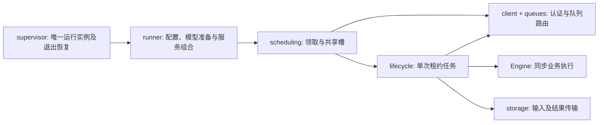

# ClapClip Worker 架构与开发

## 独立本地入口

`local` 是不经过 runner/client 的独立入口：`local_web.Workbench` 持有本地任务、按可运行任务分派的有界执行池、取消事件和下载配额，复用 `JobContext`、业务引擎及共享 OS 执行槽。HTTP 服务固定 loopback，使用会话令牌与 Host/Origin 检查，不读取默认 `.env`、不认证或 claim。`local_faceswap.LocalFaceSwap` 只为此入口增加整图五点对齐和融合，不改变分布式换脸的原生裁剪输入协议。静态网页随 wheel 打包；两种部署配置与平台限制见 [本地模式](local-mode.md)。

MediaWorker 在 `main` 上统一维护。Windows 可用 Python 3.13、DirectML 和下载依赖运行一个业务实例，命令为 `run --all-capabilities`；该入口清除旧的 AI-only claim 子集，并要求配置的每个引擎成功加载后才认证上线。默认一个实例包含三十个动态选择已就绪单项 AI 能力的 poller 和十个下载 poller，共用最多三十个 OS 文件锁执行槽，下载同时最多十个任务。旧版 NCNN 放大、独立下载 HTTP 服务及拆分下载进程入口已移除。模型输入、融合、任务租约与媒体准入策略均不变。

## 职责与资源所有权

| 模块 | 职责 | 所有的资源 |
| --- | --- | --- |
| `config.py` / `__main__.py` | 本地/分布式 CLI 与环境配置；完整能力用于注册，claim子集用于运行 | 配置对象；不持有任务租约 |
| `runner.py` | 模型准备与预热、注册、KeepAwake、退出信号、组合 poller 与可选 updater | 进程服务、引擎 registry、HTTP client 上下文 |
| `scheduling.py` | 每组能力独立领取；失败退避；取消、空队列和完成时统一释放槽 | 每轮取得的跨进程 `FileLock` 槽，持有至任务结束 |
| `queues.py` | AI及下载API的路径适配、ACK绑定、续期间隔与队列失败格式 | 当前 client 内的任务路由表；不发网络请求 |
| `client.py` | 认证、共享 token 轮转、claim/heartbeat/complete/fail 的HTTP契约 | AsyncClient、认证锁；只在明确ACK成功后移除对应路由 |
| `lifecycle.py` | 输入下载→线程执行→确认租约→上传→终态ACK→清理 | 当前attempt目录、heartbeat协程、取消事件、进度快照与推理future |
| `engine/base.py` | `JobContext`、`RunResult`、上传限值和失败报告契约 | 无进程调度资源 |
| 业务 engine | 模型/媒体策略与本地结果；下载引擎拥有公开来源的受控egress和子进程 | 预热模型或每次调用的proxy/子进程；下载在finally关闭proxy |
| `supervisor.py` / `single_instance.py` | 唯一监督、接管既有实例、异常退出后再次清点；不懂队列业务 | runtime监督锁、进程句柄；清点失败或孤儿实例时拒绝重复启动 |

`runner`仅组合服务；任务生命周期与槽调度分别由 `lifecycle` 和 `scheduling` 负责。本地图片验证使用工作台，CLI只保留 `local` 和 `run`。

分布式动画换脸显式使用 `mode=gif` / `targetMedia=gif`，由 `faceswap_gif` 调用既有换脸与识别模型，`gif_media` 负责有界预检和流式编码。静态浏览器裁剪协议不变；声明门控、单人物匹配与预算见[GIF 契约](faceswap-gif.md)。

## 公共任务契约

可选 `mediaworker.managed` 是独立安装管理边界：native bootstrap 安装 tools，setup 串行创建整机身份、同源预检和模型校验；受限 agent 持有全局锁、准备固定 release、排空/准入/回退；runtime 通过 runner 的可选 shutdown/注册/领取前钩子接入，不改变业务引擎或租约算法。`client` 的普通成功领取观察钩子即使失败，也不能丢弃已接受任务。OS 注册、活进程、历史轮询及近期轮询分别报告。详细协议和当前后端验收限制见[无人值守安装](one-click-contract.md)。

- `JobContext` 提供本地输入、params、attempt目录、cancel事件及progress回调。同步 `Engine.run()` 在线程中执行，返回 `RunResult(path,width,height,content_type)`。
- `Engine.result_byte_limit(params, default)` 默认沿用图片上传限值；下载引擎仅执行当前下载规则，任务可合法收紧尺寸/时长，媒体无固定字节上限。`None`仅可用于合法当前下载媒体，JSON/AI结果不能解除限值。`RunResult.duration`只用于实际媒体ffprobe结果，AI完成请求维持原字段。参见[当前下载协议](download-policy.md)。
- `Engine.failure_report(error, params)` 返回 `FailureReport`。图像维持既有错误/traceback语义；下载复用queue的公开错误码与脱敏diagnostic/phase，避免把来源stderr或签名URL发送给队列或日志。未加载引擎的异常也沿用对应队列格式。
- 下载metadata的JSON和媒体文件走同一上传与ACK路径，保留 `application/json` / `video/mp4` / `video/webm` / `audio/mpeg` 及当前占位尺寸约定。未修改服务端API或JSON字段。
- heartbeat丢失或服务端fencing为stale时，不上传/提交过期结果；上传前再次确认租约。取消时等待同步线程停止写入后才清理attempt目录；正常退出继续完成在途任务。
- claim遭遇不确定响应时不立即重放；下次轮询是新请求。当前认证401刷新和既有租约/result-key约束下的ACK重试策略原样保留，没有新增重试或擅自把ACK视为可幂等重放。服务端幂等保障变化时应先审阅client契约。
- 所有 poller 共用最多三十槽，下载专项最多十槽。仅保留统一分布式运行入口和本地工作台；监督器对旧下载进程保留只读清点能力，不能再启动它。

## 接入能力

新增处理能力实现 `Engine` 的load/run，返回公共结果契约；只在有实际差异时覆盖限值或失败报告。把惰性工厂登记到 `engine/registry.py`，在 `model_registry.sync_models` 的现有准备入口加入确有必要的资源准备，并按实际节点配置启用能力。通常无需修改生命周期、调度、S3或终态ACK。

不同队列协议才需要扩展 `QueueRoutes`；无需为每个图像模型创建一种队列。保留模型加载失败只跳过相应能力的现有行为，不在每次任务中重新加载模型，不引入插件发现框架。Mac 增强使用已配置的 CoreML/CPU，其他平台保持 DirectML/CUDA 门控；推理异常不重建会话或重跑任务。

## 安全验证及发布

跨平台部署入口为 `scripts/setup-worker.py`，POSIX/PowerShell 包装器只负责找到普通 Python 3.13。共享 `deployment.py` 管理独立 portable venv、生成不覆盖已有文件的本机示例配置、离线 doctor 及显式前台启动。安装/诊断不调用模型同步、节点认证或 claim，不设置后台/自启。doctor 的依赖、文件存在、模型加载、授权配置和运行状态分开报告；显式分布式配置只核对其选定缓存的节点/API，不更改缓存。

portable 启动在本机 OS 锁内按实际 provider/模型/工具筛选能力。`runner.run_forever(available_only=True)` 仅供该入口选择：在认证前按成功加载的 registry 注册，认证后再次与服务端授权取交集；空交集停止。既有 `run --all-capabilities` 的严格门控不变，本地工作台对显式禁用的能力不加载。共享总上限三十槽、下载专项最多十槽；租约/fencing 和处理算法不变。

活跃进程通常已加载runner/client/引擎模块，但一些引擎仍有惰性库导入，updater也可能读取新源码。因此先复制已跟踪文件到忽略的 `build/` 目录，在该目录运行已安装解释器（cwd优先于editable install）。隔离目录不复制 `.env`、token、模型或用户媒体；临时测试显式关闭dotenv加载。

公共生命周期改变应运行完整unittest；独立下载环境运行 `test_download*.py`、`test_claim_recovery.py` 和 `test_task_lifecycle.py`。静态检查使用AST/语法编译和diff检查。已有本地ffmpeg生成样本回归不等于线上下载验收。

提交只在main；推送前核对自动更新/CI触发与当前运行授权。没有运行切换授权时，完成代码与本地验收，保留现有服务，明确报告尚未加载的新提交。不要用生产任务作为默认回归测试。

## 传输恢复与失败分类

匿名输入 GET 仅对网络、超时和远端协议断流最多尝试三次，退避 0.5/1 秒。每次从零截断重写，拒绝声明长度与实际流长度不符的输入；失败或取消删除半成品。解码后的流仍逐块执行原字节上限，Content-Length 按编码后的 wire bytes 校验。4xx、超限与本地错误不重试。结果 PUT 维持三次上限，并包含远端协议断开；每次重新打开同一 attempt 文件，claim 不重放。

失租会终止并等待输入/上传协程，启动推理、上传和 complete 前检查所有权；引擎因失租而抛出取消或处理错误时，只丢弃本地结果，不发送普通 fail。外部协程取消仍等待同步推理结束后清理。已接受的 complete ACK 不因后续观测错误改写终态。

显式 faceswap GIF 的专用异常通过现有 fail.error 字符串发送 NO_USABLE_TARGET_FACE，含义为“未检测到可用于换脸的人脸”，不是断言素材绝对无人脸。不新增 JSON 字段，不放松检测或身份门限。仅日志记录总帧数、无可用检测帧数及身份拒绝帧数，不记录图像、关键点、身份特征或媒体路径。网站需兼容该稳定码和旧版精确文本，并自行决定确定性失败的终态及退款；Worker 不擅自修改网站记录。

下载未知错误按固定异常类型映射为 INVALID_SOURCE_JSON、NETWORK_TIMEOUT、NETWORK_PROTOCOL_ERROR、NETWORK_ERROR、OPERATION_TIMEOUT、LOCAL_IO_ERROR、INVALID_DATA、RUNTIME_ERROR 或 UNKNOWN_FAILURE；不复制异常原文或任意类名。公开错误仍沿用既有安全码，类别经固定白名单进入日志及下载失败元数据。

下载 fail ACK 可附带固定白名单的 `phase` 与 `diagnostic_code`，分别取自本次 `FailureReport`；未知值收敛为 `unknown` / `UNKNOWN_FAILURE`，公开 `error` 保持原值。仅已绑定的下载队列携带这些字段，AI 与未提供元数据的旧调用维持原 payload。出口拒绝的观测集合不当作最终失败原因；不转发 URL、headers、Cookie 或来源 stderr，也不因旧后台拒绝字段而剥离重发 ACK。旧任务不会回填或重放。

## 并发准入与独立模型上下文

`execution.py` 在领取前预留就绪单能力上下文、预计工作区与主机文件锁；空领取和不确定领取也归还票。业务 coordinator 仍只有一个，负责认证、领取、租约、上传和 ACK。每个 AI 上下文由 `model_process.py` 持有一个长期本地模型子进程和完整独立 session 子图；子进程不认证、不领取任务，IPC 仅传白名单非秘密模型配置、受控参数和本 attempt 的本地文件路径，不传账户、令牌、Cookie 或整个父进程环境。同一 session 保留原单 Run 安全锁，不用同进程多 DML session 并发绕过已观察到的运行库崩溃。模型构建与资源查询使用独立控制 executor，不能让等待上下文的任务堵住认证或下载控制。`AI_CONTEXTS` 默认 2、上限 30，同时受总任务数和全池资源账本限制。额外上下文按已接受任务的规范化模型/恢复模式按需构建，只广告实际就绪子集；预算或总上下文数不足时按 LRU 回收闲置额外上下文。

`memory.py` 区分正在构建的 resident 预留、已物化会话与尚未分配的工作区。仅在无构建票和工作区票时刷新预算；旧 epoch 的 resident 估值不能在淘汰时虚增新预算。系统可用 RAM 已含模型子进程占用；父进程的 DXGI usage 不含它们，因此所有子进程 GPU resident 预留跨 epoch 持续累计，确认对应子进程实际退出后才退款。AI 按模型文件、进程开销与最大画布作保守估算，下载每次预留 256MiB 的进程/流缓冲工作区；这是准入估算，不是实际峰值保证。CPU-only 会话只按 RAM，DirectML 按实际 session 的 device_id 查询 DXGI 进程预算。未知 GPU 预算保守等待额外上下文；CUDA 设备映射的预算仍未知，不声称通用多 GPU 峰值已验。

上下文与工作区仅在真实同步 Run 返回后归还，重复 asyncio 取消不能提前复用 native session 或删除 attempt。取消、失租、崩溃时先确认自有模型进程和读线程退出；Windows Job 在父进程死亡时终止模型子进程，监督器同时清点正常子族和无主模型进程。未确认退出时保留调用、预算与任务槽。死亡上下文只为未来领取重建，不重跑已接受任务。OS 总任务槽和下载专项槽一直持有到上传、终态 ACK 与清理结束；因此少量 AI 上下文配合 I/O 重叠仍可达到三十个在途任务。本地入口先挑可执行队列项再提交线程，下载配额满不会阻塞有上下文的 AI。

升级保持原 slots/slot-{i} 命名空间，扩展到 0..29，并新增 download-slots/slot-{i} 的 0..9 专项锁。旧版本没有下载专项锁，禁止新旧业务族并存；切换必须先持住全部三十总槽与十个下载槽、排空旧任务到 ACK、确认旧族退出，再验证新族就绪后准入。现役显式 CONCURRENCY=3 的部署不会仅因默认变化自动变成 30，发布切换须单独核对实际配置。生成模型的多会话机制验证不等于私有业务模型的双份加载或十倍吞吐已验。
