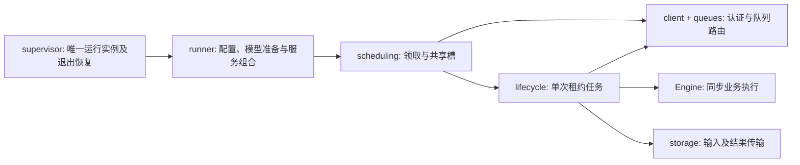

# ClapClip Worker 架构与开发

## 独立本地入口

`local` 是不经过 runner/client 的独立入口：`local_web.Workbench` 持有本地任务、三线程执行池、取消事件和下载互斥，复用 `JobContext`、业务引擎及共享 OS 执行槽。HTTP 服务固定 loopback，使用会话令牌与 Host/Origin 检查，不读取默认 `.env`、不认证或 claim。`local_faceswap.LocalFaceSwap` 只为此入口增加整图五点对齐和融合，不改变分布式换脸的原生裁剪输入协议。静态网页随 wheel 打包；两种部署配置与平台限制见 [本地模式](local-mode.md)。

MediaWorker 在 `main` 上统一维护。Windows 可用 Python 3.13、DirectML 和下载依赖运行一个业务实例，命令为 `run --all-capabilities`；该入口清除旧的 AI-only claim 子集，并要求配置的每个引擎成功加载后才认证上线。一个实例包含三个 AI poller 和一个下载 poller，共用最多三个 OS 文件锁执行槽，下载同时最多一个任务。旧版 NCNN 放大、独立下载 HTTP 服务及拆分下载进程入口已移除。模型输入、融合、任务租约与媒体准入策略均不变。

## 职责与资源所有权

| 模块 | 职责 | 所有的资源 |
| --- | --- | --- |
| `config.py` / `__main__.py` | 本地/分布式 CLI 与环境配置；完整能力用于注册，claim子集用于运行 | 配置对象；不持有任务租约 |
| `runner.py` | 模型准备与预热、注册、KeepAwake、退出信号、组合 poller 与可选 updater | 进程服务、引擎 registry、HTTP client 上下文 |
| `scheduling.py` | 每组能力独立领取；失败退避；取消、空队列和完成时统一释放槽 | 每轮取得的跨进程 `FileLock` 槽，持有至任务结束 |
| `queues.py` | AI及下载API的路径适配、ACK绑定、续期间隔与队列失败格式 | 当前 client 内的任务路由表；不发网络请求 |
| `client.py` | 认证、共享 token 轮转、claim/heartbeat/complete/fail 的HTTP契约 | AsyncClient、认证锁；只在明确ACK成功后移除对应路由 |
| `lifecycle.py` | 输入下载→线程执行→确认租约→上传→终态ACK→清理 | 当前attempt目录、heartbeat协程、取消事件、进度快照与推理future |
| `engine/base.py` | `JobContext`、`RunResult`、上传限值和失败报告契约 | 无进程调度资源 |
| 业务 engine | 模型/媒体策略与本地结果；下载引擎拥有公开来源的受控egress和子进程 | 预热模型或每次调用的proxy/子进程；下载在finally关闭proxy |
| `supervisor.py` / `single_instance.py` | 唯一监督、接管既有实例、异常退出后再次清点；不懂队列业务 | runtime监督锁、进程句柄；清点失败或孤儿实例时拒绝重复启动 |

`runner`仅组合服务；任务生命周期与槽调度分别由 `lifecycle` 和 `scheduling` 负责。本地图片验证使用工作台，CLI只保留 `local` 和 `run`。

## 公共任务契约

- `JobContext` 提供本地输入、params、attempt目录、cancel事件及progress回调。同步 `Engine.run()` 在线程中执行，返回 `RunResult(path,width,height,content_type)`。
- `Engine.result_byte_limit(params, default)` 默认沿用图片上传限值；下载引擎仅执行当前下载规则，任务可合法收紧尺寸/时长，媒体无固定字节上限。`None`仅可用于合法当前下载媒体，JSON/AI结果不能解除限值。`RunResult.duration`只用于实际媒体ffprobe结果，AI完成请求维持原字段。参见[当前下载协议](download-policy.md)。
- `Engine.failure_report(error, params)` 返回 `FailureReport`。图像维持既有错误/traceback语义；下载复用queue的公开错误码与脱敏diagnostic/phase，避免把来源stderr或签名URL发送给队列或日志。未加载引擎的异常也沿用对应队列格式。
- 下载metadata的JSON和媒体文件走同一上传与ACK路径，保留 `application/json` / `video/mp4` / `video/webm` / `audio/mpeg` 及当前占位尺寸约定。未修改服务端API或JSON字段。
- heartbeat丢失或服务端fencing为stale时，不上传/提交过期结果；上传前再次确认租约。取消时等待同步线程停止写入后才清理attempt目录；正常退出继续完成在途任务。
- claim遭遇不确定响应时不立即重放；下次轮询是新请求。当前认证401刷新和既有租约/result-key约束下的ACK重试策略原样保留，没有新增重试或擅自把ACK视为可幂等重放。服务端幂等保障变化时应先审阅client契约。
- 所有 poller 共用最多三槽，下载只有一个 poller。仅保留统一分布式运行入口和本地工作台；监督器对旧下载进程保留只读清点能力，不能再启动它。

## 接入能力

新增处理能力实现 `Engine` 的load/run，返回公共结果契约；只在有实际差异时覆盖限值或失败报告。把惰性工厂登记到 `engine/registry.py`，在 `model_registry.sync_models` 的现有准备入口加入确有必要的资源准备，并按实际节点配置启用能力。通常无需修改生命周期、调度、S3或终态ACK。

不同队列协议才需要扩展 `QueueRoutes`；无需为每个图像模型创建一种队列。保留模型加载失败只跳过相应能力的现有行为，不在每次任务中重新加载模型，不引入插件发现框架。

## 安全验证及发布

活跃进程通常已加载runner/client/引擎模块，但一些引擎仍有惰性库导入，updater也可能读取新源码。因此先复制已跟踪文件到忽略的 `build/` 目录，在该目录运行已安装解释器（cwd优先于editable install）。隔离目录不复制 `.env`、token、模型或用户媒体；临时测试显式关闭dotenv加载。

公共生命周期改变应运行完整unittest；独立下载环境运行 `test_download*.py`、`test_claim_recovery.py` 和 `test_task_lifecycle.py`。静态检查使用AST/语法编译和diff检查。已有本地ffmpeg生成样本回归不等于线上下载验收。

提交只在main；推送前核对自动更新/CI触发与当前运行授权。没有运行切换授权时，完成代码与本地验收，保留现有服务，明确报告尚未加载的新提交。不要用生产任务作为默认回归测试。
